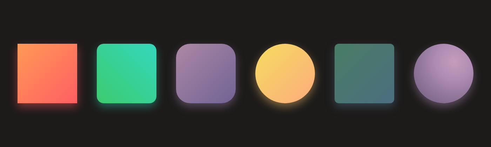

# css-shape-hover

HTML5 作业：用 HTML + CSS 画出六个形状，鼠标滑过时位置上移 10px、阴影偏移量变为 0、图形中间出现 `hover` 字样。

在线预览：<https://az7094.github.io/css-shape-hover/>

## 六个形状

| 形状 | 类名 | `border-radius` | 背景 |
| --- | --- | --- | --- |
| 正方形 | `.c1` | `0` | `linear-gradient(135deg,#ff9a56,#ff5e62)` |
| 小圆角矩形 | `.c2` | `20px` | `linear-gradient(45deg,#3dcb6e,#33d7bd)` |
| 大圆角矩形 | `.c3` | `40px` | `linear-gradient(135deg,#ac88a5,#706394)` |
| 圆形 | `.c4` | `50%` | `linear-gradient(135deg,#f5dd5e,#fcab7e)` |
| 微圆角正方形 | `.c5` | `12px` | `linear-gradient(135deg,#487d65,#4d6e7f)` |
| 立体球形 | `.c6` | `50%` | `radial-gradient(circle at 68% 30%, ...)` |

## 悬停效果的实现

* 公共类 `.cube` 负责尺寸、居中（`flex`）和默认阴影：`box-shadow: 0 10px 24px var(--glow);`
* `.cube:hover`：`transform: translateY(-10px)` + `box-shadow: 0 0 24px var(--glow)`（偏移量归零）
* `.cube::after`：`content: "hover"`，靠 flex 居中，默认 `opacity: 0`，`:hover` 时淡入
* 每个形状用 `--glow` 变量声明自己的阴影颜色
